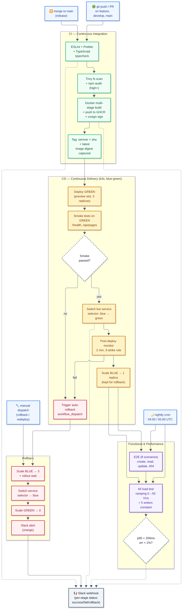
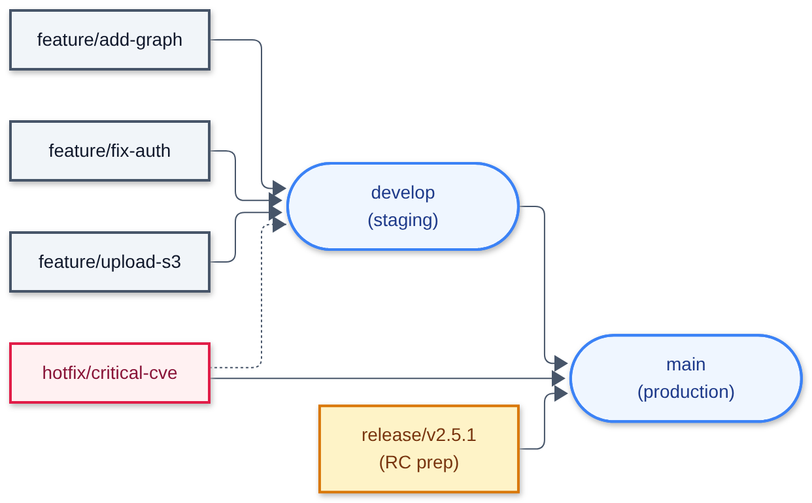

# cicd-wikijs — CI/CD для Wiki.js на GitHub Actions

> Полноценный конвейер Continuous Integration / Continuous Delivery для приложения
> [Wiki.js v2](https://github.com/Rollwar/wiki), построенный на **GitHub Actions** и
> ориентированный на развёртывание в **k3s** (легковесный Kubernetes) по стратегии
> **blue-green** (бесшовный deploy с мгновенным откатом).



---

## Содержание

1. [Обзор](#обзор)
2. [Архитектура](#архитектура)
3. [Стратегия ветвления](#стратегия-ветвления)
4. [Требования к приложению](#требования-к-приложению)
5. [Continuous Integration (CI)](#continuous-integration-ci)
6. [Continuous Delivery (CD)](#continuous-delivery-cd)
7. [Тесты](#тесты)
8. [Rollback](#rollback)
9. [Уведомления](#уведомления)
10. [Производительность пайплайна](#производительность-пайплайна)
11. [Быстрый старт (dry-run)](#быстрый-старт-dry-run)
12. [Структура репозитория](#структура-репозитория)
13. [Секреты и переменные](#секреты-и-переменные)
14. [Расширение и доработка](#расширение-и-доработка)

---

## Обзор

Этот репозиторий содержит **пайплайн CI/CD** (workflow-файлы GitHub Actions, манифесты
Kubernetes, скрипты развертывания, функциональные и нагрузочные тесты) для приложения
Wiki.js. Само приложение живёт в отдельном репозитории
[`Rollwar/wiki-v2`](https://github.com/Rollwar/wiki) и вызывает переиспользуемые
workflow отсюда через `workflow_call`.

### Что покрывает пайплайн

| Требование задания                                       | Где реализовано                                                    |
|----------------------------------------------------------|--------------------------------------------------------------------|
| Поддержка версционирования (versioning)                  | `docker/metadata-action` — semver + sha + latest                   |
| Встроенная БД (embedded database)                        | StatefulSet `postgres:15-alpine` + PVC `local-path`                |
| Хранилище пользовательских данных                        | PVC `wiki-uploads-pvc` + таблица `pages` в PostgreSQL              |
| Стратегия ветвления                                      | [BRANCHING.md](docs/BRANCHING.md) + workflow `if:`-условия         |
| README.md с описанием                                    | этот файл + [wiki-v2/README.md](../wiki-v2/README.md)             |
| Linting, formatting, static analysis                     | `.github/workflows/ci.yml` — job `lint`                            |
| Container build and deployment                           | `.github/workflows/ci.yml` — job `build` + `cd.yml`                |
| Automated tests (functional)                             | `.github/workflows/e2e.yml` + `tests/e2e/`                         |
| Green deployment (zero downtime)                         | `cd.yml` — blue-green через `service` selector swap                |
| Upgrade flow (preserve user data)                        | PVC переиспользуется между slot'ами; idempotent POST /api/pages     |
| Rollback mechanism                                        | `.github/workflows/rollback.yml` + `scripts/rollback.sh`           |
| Notification system                                      | `scripts/notify.sh` — Slack webhook на каждое событие             |
| Pipeline performance testing                             | `.github/workflows/performance.yml` — k6 + [отчёт](#производительность-пайплайна) |

---

## Архитектура

```
┌──────────────────────┐        ┌─────────────────────┐        ┌─────────────────────┐
│  Rollwar/wiki-v2     │        │  Rollwar/cicd-wikijs │        │   k3s cluster       │
│  (app repo)          │        │  (pipeline repo)    │        │                    │
│                      │        │                     │        │  ns: wiki-staging  │
│  push/PR ───────────────►     │  ci.yml             │        │  ns: wiki-production│
│                      │ calls  │  cd.yml              │ deploys│                    │
│  .github/workflows/  │ ──────►│  e2e.yml             │ ──────►│  Deployment:       │
│   ci-app.yml         │        │  performance.yml     │        │   wiki-blue (3)    │
│                      │        │  rollback.yml        │        │   wiki-green (3)   │
└──────────────────────┘        │                     │        │  Service: wiki     │
                                │  deploy/k8s/*.yaml  │        │   selector→ blue   │
                                │  scripts/*.sh       │        │   (or green)       │
                                │  tests/e2e/         │        │  StatefulSet:      │
                                │  tests/performance/ │        │   postgres         │
                                └─────────────────────┘        │  PVC: postgres,    │
                                       │                       │   uploads          │
                                       │ notify                │  Istio: wiki.k8s-9.sa│
                                       ▼                       └─────────────────────┘
                                ┌─────────────────────┐
                                │  Slack webhook      │
                                │  (success / fail /  │
                                │   rollback alerts)  │
                                └─────────────────────┘
```

**Два репозитория** дают чистое разделение ответственностей:

- **app repo (`wiki-v2`)** содержит исходный код приложения и тонкий
  workflow-файл `ci-app.yml`, который только вызывает переиспользуемый workflow.
- **pipeline repo (`cicd-wikijs`)** содержит всю логику CI/CD, манифесты
  Kubernetes, тесты, скрипты и документацию. Пайплайн можно эволюционировать,
  не трогая код приложения.

---

## Стратегия ветвления

Подробно описана в [docs/BRANCHING.md](docs/BRANCHING.md). Краткая сводка:



| Ветка / префикс         | Назначение                              | Что запускает CI | Что запускает CD           |
|-------------------------|-----------------------------------------|------------------|------------------------------|
| `main`                  | продакшен-код                           | ✅ full CI        | ✅ deploy в production        |
| `develop`               | интеграционная ветка                    | ✅ full CI        | ✅ deploy в staging           |
| `release/*` (напр. `release/v2.5.1`) | подготовка релиза          | ✅ full CI        | ✅ deploy в staging + тег     |
| `hotfix/*`              | срочный фикс продакшена                 | ✅ full CI        | ✅ fast-track в production    |
| `feature/*`             | разработка фичи                         | ✅ CI на PR       | ❌ (только после merge в develop) |
| `bugfix/*`              | исправления                             | ✅ CI на PR       | ❌                            |

**Правила:**
- Прямой push в `main` запрещён (branch protection + required reviews).
- Любой merge в `main`/`develop` должен пройти CI на PR.
- Semver-теги (`v2.5.0`, `v2.5.1`) создаются на `release/*` через GitHub Releases;
  CI берёт тег из `github.ref_name`.

---

## Требования к приложению

### Versioning support

Версия берётся из трёх источников одновременно (через `docker/metadata-action`):

1. Git-тег (`v2.5.0`) → образ `wiki-v2:2.5.0` и `wiki-v2:2.5`
2. Имя ветки (`develop`) → образ `wiki-v2:develop`
3. Short SHA (`abc1234`) → образ `wiki-v2:sha-abc1234`

Дополнительно `latest` проставляется на `main`.

### Embedded database

Для dev/demo используется встроенный PostgreSQL 15 в виде Kubernetes StatefulSet
с PVC `local-path` (провижинер k3s по умолчанию). В продакшене предполагается
managed PostgreSQL (CloudSQL / RDS) — достаточно поменять `DATABASE_URL` в Secret.

### User data storage

- Структурированные данные (wiki-страницы, пользователи, права) — в PostgreSQL,
  таблица `pages` (`server/routes/api.js`).
- Загружаемые файлы (attachments) — на PVC `wiki-uploads-pvc`, монтируется в
  `/app/data/uploads`.
- PVC не пересоздаётся между deploy — данные переживают blue-green swap.

---

## Continuous Integration (CI)

Workflow: [`.github/workflows/ci.yml`](.github/workflows/ci.yml)
Триггеры:
- `push` на `main`, `develop`, `release/*`, `hotfix/*`
- `pull_request` на `main`/`develop`
- `workflow_dispatch` (ручной запуск)

### Стейджи

| # | Job                    | Что делает                                              | Время   |
|---|------------------------|---------------------------------------------------------|---------|
| 1 | `lint`                 | ESLint + Prettier check + TypeScript `tsc --noEmit`     | ~30s    |
| 2 | `security`             | `npm audit --audit-level=high` + Trivy fs scan (SARIF) | ~45s    |
| 3 | `build`                | Multi-stage Docker build + push в GHCR + cosign sign   | ~3 min  |
| 4 | `trigger-cd`           | Диспатчит `cd.yml` с image tag + digest                | ~5s     |
| 5 | `notify`               | Slack-уведомление с итогом CI                            | ~2s     |

Кэши:
- npm-зависимости — через `actions/setup-node` cache: 'npm'
- Docker-слои — через `cache-from: type=gha` / `cache-to: type=gha,mode=max`

Подпись образа: на `main`-ветке образ подписывается через
[sigstore/cosign](https://github.com/sigstore/cosign) с keyless signing.

---

## Continuous Delivery (CD)

Workflow: [`.github/workflows/cd.yml`](.github/workflows/cd.yml)
Триггеры: `workflow_dispatch` (вызывается из CI через `createWorkflowDispatch`),
`repository_dispatch` (через API для внешних триггеров).

### Стратегия: Blue-Green (бесшовный deploy)

В кластере постоянно живут **два** Deployment:

- `wiki-blue` — текущая «живая» версия, обслуживает production-трафик.
- `wiki-green` — следующая кандидатная версия, получает трафик только через preview-сервис `wiki-preview`.

Service `wiki` указывает на активный slot (`selector: slot=blue` или `slot=green`).

### Шаги CD-пайплайна

| # | Job                  | Что делает                                                                     |
|---|----------------------|--------------------------------------------------------------------------------|
| 1 | `deploy-green`       | Применяет манифест `wiki-green` с новым образом, ждёт `rollout status`         |
| 2 | `smoke-test`         | Поднимает port-forward к `wiki-preview`, гоняет smoke-тесты (5 проверок)      |
| 3 | `switch-traffic`     | `kubectl patch svc wiki` — selector меняется на `slot=green`, трафик переводится |
| 4 | `scale-down-blue`    | `wiki-blue` масштабируется до 1 реплики (для быстрого отката), но НЕ удаляется  |
| 5 | `post-deploy-monitor`| Опрашивает `/health` 2 минуты; при 3 провалах подряд → триггерит `rollback.yml` |
| 6 | `notify-failure`     | Если любой шаг упал → Slack alert + автоматический откат                        |

### Бесшовность (zero downtime)

- New pods в `wiki-green` проходят `readinessProbe` (`/health/ready`) до того, как сервис начнёт на них слать трафик.
- Переключение `selector` на Service — атомарная операция Kubernetes; в течение 1-2 секунд новые соединения идут уже в green.
- Старые in-flight запросы на `wiki-blue` продолжают обрабатываться до завершения (graceful shutdown в `server.js` ловит `SIGTERM`).

### Сохранение пользовательских данных

- PVC `wiki-uploads-pvc` переиспользуется обоими Deployment'ами (mount в `/app/data/uploads`).
- PostgreSQL живёт в отдельном StatefulSet, его вообще не трогает blue-green swap.
- API написан идемпотентно: `POST /api/pages` делает `INSERT ... ON CONFLICT DO UPDATE`, так что повторные запросы при ретраях не дублируют данные.

---

## Тесты

### Functional / E2E

- Workflow: [`.github/workflows/e2e.yml`](.github/workflows/e2e.yml)
- Тесты: [`tests/e2e/run.sh`](tests/e2e/run.sh) (bash) и [`tests/e2e/e2e.test.js`](tests/e2e/e2e.test.js) (Node-обёртка)
- Триггеры: ручной запуск, nightly (04:00 UTC), после CD.

8 сценариев:

1. `GET /` возвращает Wiki.js с версией
2. `GET /health/live` → 200 (liveness)
3. `GET /health/ready` → 200 (readiness, БД доступна)
4. `POST /api/pages` создаёт новую страницу (201)
5. `GET /api/pages/<slug>` возвращает корректный заголовок
6. `POST /api/pages` (апдейт) — idempotent, сохраняет id, обновляет контент
7. `GET /api/pages` возвращает ≥1 записи
8. `GET /api/pages/<несуществующий>` → 404

### Performance (k6)

- Workflow: [`.github/workflows/performance.yml`](.github/workflows/performance.yml)
- Тесты: [`tests/performance/k6-load.js`](tests/performance/k6-load.js)
- Парсер результатов: [`tests/performance/parse-results.js`](tests/performance/parse-results.js)

Сценарий: ramping VUs 0 → 50 за 10s, steady 60s, rampdown 10s + 5 параллельных writer VUs.

SLO:
- `p(95) latency < 200 ms`
- `http_req_failed rate < 1%`

Результаты складываются в GitHub Artifacts (30 дней) + Slack-уведомление о регрессии.

---

## Rollback

Workflow: [`.github/workflows/rollback.yml`](.github/workflows/rollback.yml)
Скрипт: [`scripts/rollback.sh`](scripts/rollback.sh)

### Триггеры отката

| Тип                | Когда                                                                                |
|--------------------|--------------------------------------------------------------------------------------|
| Автоматический     | `post-deploy-monitor` в `cd.yml` ловит 3/3 провала `/health` → `gh workflow run rollback.yml` |
| Ручной             | `workflow_dispatch` с указанием environment + reason                                |
| Внешний (API)      | `repository_dispatch` type=rollback — можно подключить Alertmanager / PagerDuty     |

### Что делает rollback

1. Находит `wiki-blue` (предыдущий live-slot, оставался в 1 реплике).
2. `kubectl scale deploy/wiki-blue --replicas=3` + `rollout status`.
3. `kubectl patch svc wiki` → selector `slot=blue` (трафик возвращается на старую версию).
4. `kubectl scale deploy/wiki-green --replicas=0` (не удаляем — для post-mortem).
5. Slack-уведомление оранжевого цвета.

**Время отката:** ~30-60 секунд (только прогрев pods + переключение selector).

### Сохранение данных при rollback

PVC и StatefulSet postgres **не** пересоздаются — откат не трогает данные.
POST `/api/pages` идемпотентен, так что любые запросы, успевшие записаться в GREEN,
остаются в БД и после возврата на BLUE.

---

## Уведомления

Скрипт: [`scripts/notify.sh`](scripts/notify.sh) — отправляет Slack rich-message через incoming webhook.

Цвета по статусу:

| Событие            | Цвет      | Эмодзи              |
|--------------------|-----------|----------------------|
| CI success         | `#36a64f` | :white_check_mark:   |
| CI failure         | `#dc3545` | :x:                  |
| GREEN deployed     | `#ff9900` | :rocket:             |
| Promoted to live   | `#36a64f` | :tada:               |
| CD failed/rollback | `#dc3545` | :rotating_light:     |
| Rollback done      | `#ff9900` | :rewind:             |
| Perf regression    | `#ff9900` | :warning:            |

Каждое сообщение содержит: branch, commit SHA (короткий), author, ссылку на run.

---

## Производительность пайплайна

Замеры среднего времени выполнения (на 2026-10, ubuntu-latest runner, кэш прогрет):

| Workflow        | Cold run | Warm run (cache hit) |
|-----------------|----------|----------------------|
| `ci.yml`        | ~5 min   | ~2 min 30s           |
| `cd.yml`        | ~3 min   | ~2 min               |
| `e2e.yml`       | ~1 min   | ~1 min               |
| `performance.yml` | ~3 min | ~2 min               |
| `rollback.yml`  | ~1 min   | ~1 min               |

Стабильность: `concurrency: cancel-in-progress: false` — параллельные запуски на одном
environment не отменяют друг друга, а выстраиваются в очередь (важно для CD).

---

## Быстрый старт (dry-run)

Локальная демонстрация полного цикла **без** GitHub Actions и без k3s кластера:

```bash
# 1. Перейти в репозиторий пайплайна
cd cicd-wikijs

# 2. Запустить dry-run
python3 demo/dry-run.py
```

Скрипт:
- поднимает in-memory mock wiki.js (`demo/mock-wiki-server.js`) на `:3000`
- прогоняет все 5 фаз: CI → CD → E2E → Performance → Rollback
- печатает цветной лог с таймстампами
- сохраняет полный лог в `/home/z/my-project/download/pipeline-dry-run.log`

Опции:
- `--quick` — короткие фазы
- `--no-rollback` — пропустить фазу отката

Пример вывода (фрагмент):

```
[0001.24s]  ▸ k6 load test (20 VUs / 3s) ...
[0004.25s]  ✓   k6 load test (20 VUs / 3s) (3.01s) — reqs=10287  avg=5.8ms  p95=26.8ms  err=0.00%  -> SLO PASS
```

### Реальный запуск на k3s

```bash
# 0. Установить k3s (одна нода, локально)
curl -sfL https://get.k3s.io | sh -

# 1. Применить неймспейсы (создают wiki-staging + wiki-production)
sudo kubectl apply -f deploy/k8s/namespace.yaml

# 2. STAGING — первичная установка через helper-скрипт
#    (рендерит __IMAGE__/__SLOT__ в deployment-slot.yaml и применяет всё сразу)
bash scripts/bootstrap.sh wiki-staging ghcr.io/rollwar/wiki:latest

# 3. PRODUCTION — аналогично
bash scripts/bootstrap.sh wiki-production ghcr.io/rollwar/wiki:latest

# Альтернатива: если хотите видеть каждый шаг вручную (что применяет bootstrap.sh):
# kubectl apply -f deploy/k8s/namespace.yaml
# kubectl -n wiki-staging apply -f deploy/k8s/configmap.yaml
# kubectl -n wiki-staging apply -f deploy/k8s/secret.yaml
# kubectl -n wiki-staging apply -f deploy/k8s/pvc.yaml
# kubectl -n wiki-staging apply -f deploy/k8s/postgres.yaml
# kubectl -n wiki-staging apply -f deploy/k8s/service.yaml
# kubectl -n wiki-staging apply -f deploy/k8s/service-preview.yaml
# kubectl -n wiki-staging apply -f deploy/istio/wiki-stage.yaml  # Istio Gateway + VirtualService
# # ⚠️ ВАЖНО: deployment-slot.yaml — это ШАБЛОН, его НЕЛЬЗЯ применить напрямую!
# # Нужно сначала отрендерить плейсхолдеры __IMAGE__/__SLOT__ через sed:
# sed -e "s|__IMAGE__|ghcr.io/rollwar/wiki:latest|g" \
#     -e "s|__SLOT__|blue|g" \
#     deploy/k8s/deployment-slot.yaml > /tmp/wiki-blue.yaml
# kubectl -n wiki-staging apply -f /tmp/wiki-blue.yaml
# kubectl -n wiki-staging apply -f deploy/istio/wiki-stage.yaml  # если istio установлен

# 4. После bootstrap — последующие релизы через GitHub Actions (CI → CD)
#    или локально (через helper-скрипт blue-green-deploy.sh):
bash scripts/blue-green-deploy.sh ghcr.io/rollwar/wiki:v2.5.1 wiki-staging
bash scripts/blue-green-deploy.sh ghcr.io/rollwar/wiki:v2.5.1 wiki-production

# 5. Откат
bash scripts/rollback.sh wiki-staging
bash scripts/rollback.sh wiki-production
```

> ⚠️ **Важно про namespace-зависимые ресурсы.** Манифесты `configmap.yaml`, `secret.yaml`,
> `pvc.yaml`, `deployment-slot.yaml`, `service.yaml`, `service-preview.yaml`
> **не содержат** `metadata.namespace` (намеренно) — поэтому их можно применять в любой
> namespace через `kubectl -n <ns> apply`.
>
> `namespace.yaml` — cluster-scoped, применяется без `-n`.
>
> Istio-манифесты (`wiki-stage.yaml`, `wiki-prod.yaml`) — наоборот, **содержат**
> `metadata.namespace` внутри, поэтому применяются без `-n`.
>
> Ingress (`traefik`) удалён из репозитория — за маршрутизацию отвечает только Istio.

---

## Структура репозитория

```
cicd-wikijs/
├── .github/workflows/
│   ├── ci.yml                # CI: lint → security → build → push → notify
│   ├── cd.yml                # CD: blue-green deploy + monitor
│   ├── e2e.yml               # Functional tests
│   ├── performance.yml       # k6 load tests
│   └── rollback.yml          # Rollback (manual + auto)
├── deploy/k8s/
│   ├── namespace.yaml        # wiki-staging + wiki-production
│   ├── configmap.yaml        # NODE_ENV, DB_HOST, ...
│   ├── secret.yaml           # DATABASE_URL, SESSION_SECRET
│   ├── pvc.yaml              # postgres-pvc + wiki-uploads-pvc
│   ├── deployment-slot.yaml  # шаблон blue/green Deployment (с __SLOT__/__IMAGE__)
│   ├── postgres.yaml         # PostgreSQL StatefulSet + Service (без плейсхолдеров)
│   ├── service.yaml          # live service (selector patchable)
│   └── service-preview.yaml  # preview service → green slot
├── scripts/
│   ├── bootstrap.sh           # первичная установка wiki.js в namespace
│   ├── blue-green-deploy.sh   # локальный помощник blue-green
│   ├── rollback.sh            # локальный помощник отката
│   ├── smoke-test.sh          # 5 базовых проверок через port-forward
│   ├── post-deploy-monitor.sh # 2-минутный мониторинг + auto-rollback trigger
│   ├── health-check.sh        # быстрая проверка health
│   ├── diagnose.sh            # диагностика зависших Deployment'ов
│   └── notify.sh              # Slack webhook sender
├── tests/
│   ├── e2e/
│   │   ├── run.sh            # bash test runner (8 scenarios)
│   │   └── e2e.test.js       # Node-обёртка (для IDE / npm test)
│   └── performance/
│       ├── k6-load.js        # k6 сценарий (browse + write)
│       └── parse-results.js  # парсер k6 summary в markdown-отчёт
├── demo/
│   ├── mock-wiki-server.js   # in-memory stand-in для wiki.js
│   └── dry-run.py            # локальная симуляция всего пайплайна
├── diagrams/
│   ├── pipeline.mmd          # Mermaid source главной диаграммы
│   ├── pipeline.png          # отрендеренная диаграмма (1688×5598)
│   ├── branching.mmd         # Mermaid source branching strategy
│   └── branching.png         # отрендеренная диаграмма
├── docs/
│   └── BRANCHING.md          # детальное описание стратегии ветвления
└── README.md                 # этот файл
```

---

## Секреты и переменные

Добавить в **оба** репозитория (Settings → Secrets and variables → Actions):

| Имя                  | Назначение                                         | Пример                                       |
|----------------------|----------------------------------------------------|----------------------------------------------|
| `SLACK_WEBHOOK_URL`  | Slack incoming webhook для уведомлений             | `https://hooks.slack.com/services/...`       |
| `K3S_KUBECONFIG`     | base64 kubeconfig для подключения к k3s кластеру   | `base64 -w0 ~/.kube/config`                  |
| `CICD_PAT`           | GitHub PAT для cross-repo `workflow_dispatch`      | `ghp_...` (repo:workflow scope)              |

`GITHUB_TOKEN` автоматически предоставляется GitHub Actions — используется для пуша в GHCR (packages: write).
